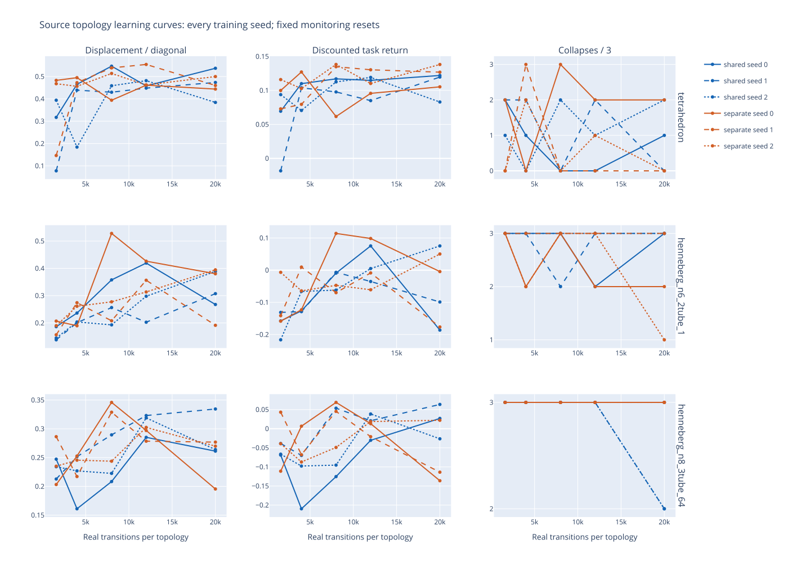
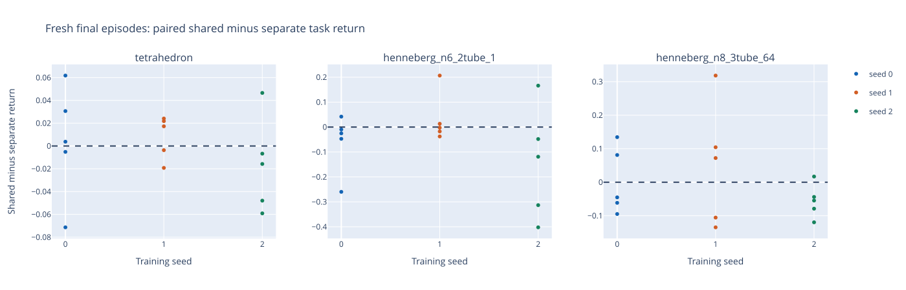

> Published measured report. Static figures are included here. Raw CSV/JSON, interactive HTML, replay and checkpoint filenames mentioned below refer to ignored local artifacts under `outputs/dynamics-pilot/online-multi-gamma095-source-2026-10-24/`; large generated artifacts are not part of this Git snapshot.

# Shared versus separate source dynamics-MPC results

All six groups completed: 360,000 real fitting transitions; 20,000 transitions and updates per topology/condition/seed. All integrity checks pass.

Elapsed campaign time: 4.01 hours. Summed group time: 11.95 hours.

[Interactive learning curves](figures/gamma095-learning-curves.svg) · [Fresh paired outcomes](figures/gamma095-fresh-final.svg)

## Gamma=.95 result and comparison with the original campaign

The .95 rerun did not provide a consistent improvement. It completed all fixed budgets without run failures. Compare both campaigns under common discount definitions in the [full discount comparison](discount_comparison_2026-10-25.md), including every topology/condition/seed, movement and collapse changes. Native .95 returns below are not directly comparable to native .995 returns.

[Common-discount comparison curves](figures/discount-comparison-learning-curves.svg)

All 732 native and 208 completion integrity checks pass; cross-discount actual starts, initialization, warmups and normalization match. The six-node shared condition collapses on all 15 fresh starts, compared with 9/15 under the original .995 controller. Tetrahedron specialists regress from 0/15 to 5/15 collapses, while six-node specialists improve from 13/15 to 11/15. Both eight-node methods remain at 15/15. No blanket gamma improvement or sharing-without-sacrifice conclusion is supported.

## Fresh final outcomes by topology and training seed

| Topology | Seed | Shared return | Separate return | Shared − separate return | Displacement difference | Collapse difference |
|---|---:|---:|---:|---:|---:|---:|
| tetrahedron | 0 | 0.119520 | 0.115583 | +0.003937 | +0.030114 | -1 |
| tetrahedron | 1 | 0.123719 | 0.115659 | +0.008061 | +0.047008 | -1 |
| tetrahedron | 2 | 0.102169 | 0.118769 | -0.016601 | -0.066913 | +0 |
| henneberg_n6_2tube_1 | 0 | -0.019527 | 0.040489 | -0.060016 | -0.008499 | +1 |
| henneberg_n6_2tube_1 | 1 | 0.079261 | 0.046789 | +0.032472 | -0.060100 | +2 |
| henneberg_n6_2tube_1 | 2 | -0.123314 | 0.019914 | -0.143228 | -0.239607 | +1 |
| henneberg_n8_3tube_64 | 0 | -0.021978 | -0.024808 | +0.002830 | -0.032495 | +0 |
| henneberg_n8_3tube_64 | 1 | 0.016659 | -0.034290 | +0.050949 | +0.046427 | +0 |
| henneberg_n8_3tube_64 | 2 | -0.056376 | -0.000313 | -0.056063 | -0.063648 | +0 |

## Final metrics for every model

| Topology | Seed | Model | Movement | Return | Collapses / 5 | Plan median ms | Plan p95 ms | Common H10 progress MAE | Position RMSE m | Velocity RMSE m/s |
|---|---:|---|---:|---:|---:|---:|---:|---:|---:|---:|
| tetrahedron | 0 | shared | 0.498793 | 0.119520 | 1 | 33.14 | 62.06 | 0.005543 | 0.033337 | 0.093904 |
| tetrahedron | 0 | separate | 0.468680 | 0.115583 | 2 | 24.06 | 25.20 | 0.003312 | 0.024767 | 0.078385 |
| tetrahedron | 1 | shared | 0.476841 | 0.123719 | 0 | 24.06 | 25.38 | 0.011075 | 0.069207 | 0.120678 |
| tetrahedron | 1 | separate | 0.429833 | 0.115659 | 1 | 23.45 | 25.16 | 0.007687 | 0.066039 | 0.101067 |
| tetrahedron | 2 | shared | 0.424232 | 0.102169 | 2 | 26.40 | 67.58 | 0.011187 | 0.047574 | 0.123566 |
| tetrahedron | 2 | separate | 0.491144 | 0.118769 | 2 | 23.66 | 24.24 | 0.007513 | 0.046345 | 0.091598 |
| henneberg_n6_2tube_1 | 0 | shared | 0.373252 | -0.019527 | 5 | 47.78 | 132.72 | 0.012565 | 0.078198 | 0.127971 |
| henneberg_n6_2tube_1 | 0 | separate | 0.381751 | 0.040489 | 4 | 35.33 | 116.28 | 0.012863 | 0.092146 | 0.141594 |
| henneberg_n6_2tube_1 | 1 | shared | 0.374629 | 0.079261 | 5 | 35.43 | 64.03 | 0.020250 | 0.115303 | 0.153642 |
| henneberg_n6_2tube_1 | 1 | separate | 0.434729 | 0.046789 | 3 | 35.92 | 38.48 | 0.020049 | 0.107852 | 0.150424 |
| henneberg_n6_2tube_1 | 2 | shared | 0.221394 | -0.123314 | 5 | 36.53 | 103.71 | 0.031511 | 0.143080 | 0.198011 |
| henneberg_n6_2tube_1 | 2 | separate | 0.461001 | 0.019914 | 4 | 36.87 | 37.76 | 0.025723 | 0.119121 | 0.195137 |
| henneberg_n8_3tube_64 | 0 | shared | 0.262537 | -0.021978 | 5 | 50.57 | 187.45 | 0.008211 | 0.054525 | 0.078888 |
| henneberg_n8_3tube_64 | 0 | separate | 0.295032 | -0.024808 | 5 | 52.18 | 53.74 | 0.008393 | 0.068467 | 0.090562 |
| henneberg_n8_3tube_64 | 1 | shared | 0.318068 | 0.016659 | 5 | 176.80 | 183.16 | 0.014591 | 0.100044 | 0.110475 |
| henneberg_n8_3tube_64 | 1 | separate | 0.271642 | -0.034290 | 5 | 49.39 | 53.51 | 0.015490 | 0.103847 | 0.112445 |
| henneberg_n8_3tube_64 | 2 | shared | 0.242850 | -0.056376 | 5 | 59.64 | 168.00 | 0.008856 | 0.053453 | 0.083886 |
| henneberg_n8_3tube_64 | 2 | separate | 0.306498 | -0.000313 | 5 | 53.24 | 54.75 | 0.007299 | 0.050150 | 0.083065 |

## Observed sharing effects

- tetrahedron: mean paired fresh return difference -0.001534; shared improves the seed mean in 2/3 seeds; collapse-count difference -2/15 episodes.
- henneberg_n6_2tube_1: mean paired fresh return difference -0.056924; shared improves the seed mean in 1/3 seeds; collapse-count difference +4/15 episodes.
- henneberg_n8_3tube_64: mean paired fresh return difference -0.000761; shared improves the seed mean in 2/3 seeds; collapse-count difference +0/15 episodes.

The results do not uniformly show improved return without additional collapses across every topology and seed. A blanket no-sacrifice conclusion is unsupported.

## Complete per-topology, per-seed evidence

NaN in an H10 table cell means no episode lasted ten steps; those failures remain in the control metrics. `episodes.csv` records every checkpoint/fresh episode, displacement, return, collapse and planning latency. `paired-differences.csv` records all matched differences. `prediction-errors.json` records own-controller errors at each checkpoint and both final models on the same union of fresh trajectories, with physical position/velocity RMSE and progress MAE at horizons 1/5/10/20. `integrity-audit.json` checks source hashes, exact budgets, Adam counts, replay adjacency, masked actions, paired starts, initialization, fitting warmups and normalization.

## Limits and next experiment

This compares learning across three trained source topologies. It is not evidence of unseen-topology transfer. Three seeds and five fresh resets per seed are too small to establish noninferiority or reliability. Monitoring resets repeat across checkpoints; no checkpoint was selected from their outcomes. Larger shared Adam state receives three times as many aggregate updates as each specialist, while per-topology exposures match. Fixed update order and pooled fitting-only normalization are documented design choices. Own-controller prediction errors have different state distributions; common-union final errors support comparison but are descriptive.

Recommendation: inspect each topology and training seed jointly for return, movement, failures and common-distribution prediction errors before authorizing another experiment. Do not tune or expand training automatically. A follow-up should replicate any topology-specific loss of control under a new predeclared seed set before testing unseen robots.
