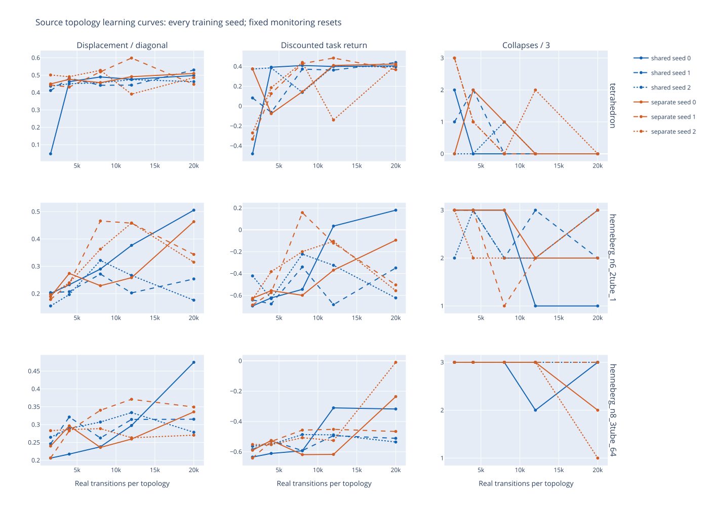
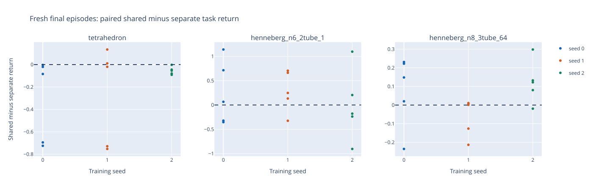

> Published measured report. Static figures are included here. Raw CSV/JSON, interactive HTML, replay and checkpoint filenames mentioned below refer to ignored local artifacts under `outputs/dynamics-pilot/online-multi-source-2026-10-24/`; large generated artifacts are not part of this Git snapshot.

# Shared versus separate source dynamics-MPC results

All six groups completed: 360,000 real fitting transitions; 20,000 transitions and updates per topology/condition/seed. All integrity checks pass.

Elapsed campaign time: 4.08 hours. Summed group time: 12.05 hours.

[Interactive learning curves](figures/shared-learning-curves.svg) · [Fresh paired outcomes](figures/shared-fresh-final.svg)

## Answer to the experiment question

**This protocol did not demonstrate shared learning without a control cost.** The shared model produced forward motion on all three trained topologies, but tetrahedron fresh-final discounted return was lower in all three training seeds, with four additional collapses. Effects on the other topologies differed, so a pooled result would be misleading.

| Trained source topology | Shared movement | Separate movement | Shared return | Separate return | Paired return difference | Shared collapses | Separate collapses |
|---|---:|---:|---:|---:|---:|---:|---:|
| tetrahedron | 0.491443 | 0.525859 | 0.225968 | 0.436420 | -0.210452 | 4/15 | 0/15 |
| henneberg_n6_2tube_1 | 0.330990 | 0.370765 | -0.192564 | -0.369286 | +0.176721 | 9/15 | 13/15 |
| henneberg_n8_3tube_64 | 0.330344 | 0.291398 | -0.485537 | -0.530968 | +0.045430 | 15/15 | 15/15 |

Movement is signed forward unique-physical-node mean displacement divided by the initial bounding-box diagonal. Task return discounts normalized progress minus routed-command effort (weight 0.1) and a unit true-collapse charge, with gamma 0.995. All early failures are retained; episodes last at most 80 control steps. Every topology has three training seeds and five independent fresh paired resets per seed.

Pooled fresh collapse counts are identical (28/45 for each condition): four additional tetrahedron collapses under sharing cancel four fewer six-node collapses. This equality hides the reliability tradeoff. The six-node shared model moves less in all three seeds; its higher return in two seeds comes with fewer collapses, rather than a uniform locomotion improvement. Both conditions collapse in every eight-node fresh episode (15/15 each); its small mean return advantage does not establish reliable control.

Final tetrahedron monitoring resets show zero collapses for both conditions and a small shared return advantage (0.413598 versus 0.401477), whereas fresh resets reveal the four shared collapses. This qualifies conclusions from the reused monitoring states. All predeclared checkpoints remain reported; none was selected using these outcomes.

## Evidence-based next experiment

Do not advance to unseen-topology transfer or automatically increase this budget. First run a separately predeclared source-only diagnostic using saved real replay and frozen checkpoints: compare shared and specialist recursive state/progress and collapse errors near the observed failures, and measure per-topology dynamics gradients on the same balanced real examples. Treat gradient interference as a hypothesis, not an established cause. The tetrahedron degradation is specific to sharing here, while poor eight-node survival is common to both methods and needs a distinct explanation. Then replicate the fixed shared-versus-separate comparison on an independently declared seed/reset set before concluding that a proposed source-only repair removes the tradeoff. No such diagnostic, repair, additional training or unseen evaluation was executed in this campaign.

Planning times are measured under changing concurrent CPU load. The same dynamics architecture and planner are used in both conditions; the latency differences do not establish an intrinsic sharing speedup. Common-distribution final prediction errors show no uniform sharing advantage across every topology and seed, and low average progress error does not guarantee survival.

## Completion verification

All 732 automatic integrity checks and 208 additional completion checks pass. The latter independently recompute warm-up normalization, verify every milestone checkpoint and replay count, finite real transitions, actual alias equality, episode limits/boundary markers, valid recursive starts, shared parameter/optimizer identity, distinct fresh starts and source snapshots. Total real fitting transitions are exactly 360,000. Every topology contributes 20,000 updates, 640,000 one-step draws, 640,000 five-step windows and 3,200,000 recursive target exposures. Shared Adam has 60,000 steps per seed; each specialist Adam has 20,000. Check `verification/completion-audit.json`, `integrity-audit.json` and the preserved prelaunch test logs. No numerical run failures or operational restarts occurred.

Campaign time until all six reports: 4.0779 hours elapsed and 12.0476 summed group wall hours; the predeclared benchmark estimate was 4.6802 elapsed / 14.0407 aggregate hours. Post-run artifact rendering, inspection and note updates are additional and are not included in training time.

Both figures were visually inspected. Initial automatic SVG export was blocked by the sandboxed browser; the unchanged plotted data were subsequently rendered successfully to PNG/SVG through the available Chrome runtime. Original export errors remain in summary.json. Final figure postprocessing only makes seed colors consistent across panels and labels axes; it does not change measurements. The original automatic report is preserved at verification/automatic-report.md. All generated datasets, checkpoints and figures remain ignored.

## Fresh final outcomes by topology and training seed

| Topology | Seed | Shared return | Separate return | Shared − separate return | Displacement difference | Collapse difference |
|---|---:|---:|---:|---:|---:|---:|
| tetrahedron | 0 | 0.132162 | 0.437716 | -0.305554 | -0.030853 | +2 |
| tetrahedron | 1 | 0.141657 | 0.412999 | -0.271342 | +0.004462 | +2 |
| tetrahedron | 2 | 0.404086 | 0.458545 | -0.054459 | -0.076857 | +0 |
| henneberg_n6_2tube_1 | 0 | -0.234451 | -0.483704 | +0.249253 | -0.038588 | -2 |
| henneberg_n6_2tube_1 | 1 | -0.172719 | -0.457265 | +0.284545 | -0.054406 | -2 |
| henneberg_n6_2tube_1 | 2 | -0.170522 | -0.166888 | -0.003634 | -0.026331 | +0 |
| henneberg_n8_3tube_64 | 0 | -0.452400 | -0.529654 | +0.077254 | +0.066663 | +0 |
| henneberg_n8_3tube_64 | 1 | -0.506866 | -0.443115 | -0.063751 | -0.065371 | +0 |
| henneberg_n8_3tube_64 | 2 | -0.497346 | -0.620134 | +0.122788 | +0.115545 | +0 |

## Final metrics for every model

| Topology | Seed | Model | Movement | Return | Collapses / 5 | Plan median ms | Plan p95 ms | Common H10 progress MAE | Position RMSE m | Velocity RMSE m/s |
|---|---:|---|---:|---:|---:|---:|---:|---:|---:|---:|
| tetrahedron | 0 | shared | 0.492574 | 0.132162 | 2 | 23.94 | 25.43 | 0.010816 | 0.067829 | 0.123072 |
| tetrahedron | 0 | separate | 0.523427 | 0.437716 | 0 | 24.68 | 26.57 | 0.012939 | 0.074952 | 0.151661 |
| tetrahedron | 1 | shared | 0.503871 | 0.141657 | 2 | 23.74 | 25.27 | 0.009742 | 0.074259 | 0.141941 |
| tetrahedron | 1 | separate | 0.499409 | 0.412999 | 0 | 25.11 | 26.83 | 0.008740 | 0.064939 | 0.137201 |
| tetrahedron | 2 | shared | 0.477885 | 0.404086 | 0 | 22.72 | 23.16 | 0.014872 | 0.076308 | 0.144566 |
| tetrahedron | 2 | separate | 0.554742 | 0.458545 | 0 | 22.19 | 26.58 | 0.011665 | 0.077704 | 0.107831 |
| henneberg_n6_2tube_1 | 0 | shared | 0.307446 | -0.234451 | 3 | 36.26 | 112.61 | 0.015311 | 0.101783 | 0.142818 |
| henneberg_n6_2tube_1 | 0 | separate | 0.346034 | -0.483704 | 5 | 113.72 | 117.63 | 0.017950 | 0.104869 | 0.142319 |
| henneberg_n6_2tube_1 | 1 | shared | 0.340236 | -0.172719 | 3 | 35.86 | 142.38 | 0.021050 | 0.125662 | 0.164018 |
| henneberg_n6_2tube_1 | 1 | separate | 0.394642 | -0.457265 | 5 | 41.88 | 72.59 | 0.017826 | 0.106939 | 0.161889 |
| henneberg_n6_2tube_1 | 2 | shared | 0.345287 | -0.170522 | 3 | 35.27 | 36.11 | 0.022909 | 0.117149 | 0.152949 |
| henneberg_n6_2tube_1 | 2 | separate | 0.371618 | -0.166888 | 3 | 35.26 | 36.45 | 0.016654 | 0.108415 | 0.148791 |
| henneberg_n8_3tube_64 | 0 | shared | 0.378248 | -0.452400 | 5 | 50.80 | 96.90 | 0.010134 | 0.073771 | 0.104944 |
| henneberg_n8_3tube_64 | 0 | separate | 0.311585 | -0.529654 | 5 | 168.48 | 175.84 | 0.011044 | 0.067600 | 0.097514 |
| henneberg_n8_3tube_64 | 1 | shared | 0.310804 | -0.506866 | 5 | 52.10 | 189.02 | 0.011915 | 0.076930 | 0.097170 |
| henneberg_n8_3tube_64 | 1 | separate | 0.376174 | -0.443115 | 5 | 62.15 | 101.54 | 0.010315 | 0.071674 | 0.088951 |
| henneberg_n8_3tube_64 | 2 | shared | 0.301979 | -0.497346 | 5 | 50.54 | 51.16 | 0.011081 | 0.091218 | 0.112529 |
| henneberg_n8_3tube_64 | 2 | separate | 0.186434 | -0.620134 | 5 | 48.87 | 51.02 | 0.022252 | 0.124626 | 0.128723 |

## Observed sharing effects

- tetrahedron: mean paired fresh return difference -0.210452; shared improves the seed mean in 0/3 seeds; collapse-count difference +4/15 episodes.
- henneberg_n6_2tube_1: mean paired fresh return difference +0.176721; shared improves the seed mean in 2/3 seeds; collapse-count difference -4/15 episodes.
- henneberg_n8_3tube_64: mean paired fresh return difference +0.045430; shared improves the seed mean in 2/3 seeds; collapse-count difference +0/15 episodes.

The results do not uniformly show improved return without additional collapses across every topology and seed. A blanket no-sacrifice conclusion is unsupported.

## Complete per-topology, per-seed evidence

NaN in an H10 table cell means no episode lasted ten steps; those failures remain in the control metrics. `episodes.csv` records every checkpoint/fresh episode, displacement, return, collapse and planning latency. `paired-differences.csv` records all matched differences. `prediction-errors.json` records own-controller errors at each checkpoint and both final models on the same union of fresh trajectories, with physical position/velocity RMSE and progress MAE at horizons 1/5/10/20. `integrity-audit.json` checks source hashes, exact budgets, Adam counts, replay adjacency, masked actions, paired starts, initialization, fitting warmups and normalization.

## Limits and next experiment

This compares learning across three trained source topologies. It is not evidence of unseen-topology transfer. Three seeds and five fresh resets per seed are too small to establish noninferiority or reliability. Monitoring resets repeat across checkpoints; no checkpoint was selected from their outcomes. Larger shared Adam state receives three times as many aggregate updates as each specialist, while per-topology exposures match. Fixed update order and pooled fitting-only normalization are documented design choices. Own-controller prediction errors have different state distributions; common-union final errors support comparison but are descriptive.

The recommended source-only diagnostic and independent replication are specified above. Fixed update order, common pooled warm-up normalization, only three training seeds and a small fresh-reset sample limit causal attribution and formal noninferiority claims.
